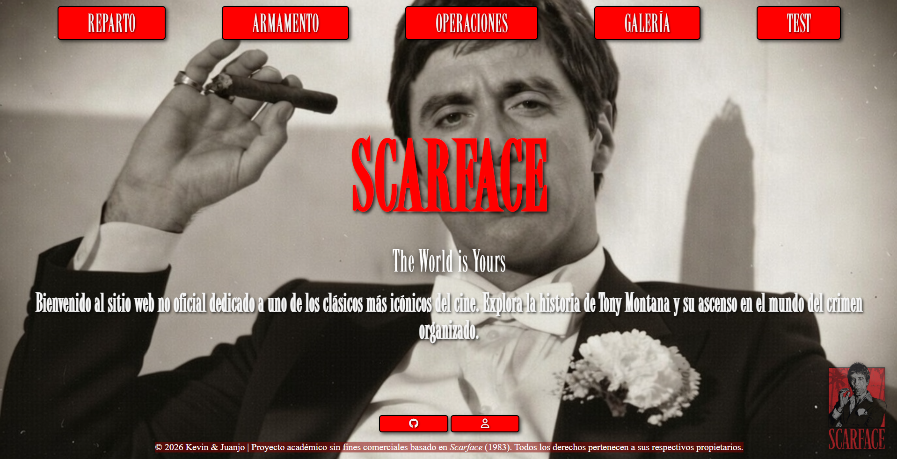

# Scarface Web

Web interactiva sobre la película *Scarface* (1983), hecha con **HTML, CSS y JavaScript**.
Proyecto final del módulo de *Lenguaje de Marcas* (1º de DAM), desarrollado en equipo de dos personas.

Web en línea: https://kevinalinstefan.github.io/ScarfaceWeb/index.html



## Páginas

- **Inicio**: frases míticas de la película que van cambiando con una animación
- **Reparto**: tarjetas de los personajes principales que se giran (con un toque en el móvil)
- **Galería**: tráiler incrustado y carrusel de imágenes
- **Armamento**: modelos 3D interactivos de las armas que salen en la película
- **Operaciones**: cómo manejaba Tony su imperio, con páginas de interés
- **Test**: "¿Qué personaje de Scarface eres?"
- **Contacto**: los miembros del equipo, con un reproductor de música propio

## Funcionalidades

- **Tema claro / oscuro**, guardado en `localStorage` para que se mantenga entre páginas y visitas
- **Carrusel de imágenes** con botones de anterior y siguiente
- **Test de personalidad** que puntúa cada respuesta y muestra el personaje que te corresponde
- **Modelos 3D** (`.glb`) que se ven en el navegador con `<model-viewer>` de Google
- **Tarjetas adaptadas a móvil**: detecta si el dispositivo no tiene hover y cambia a girar con un toque
- Pantallas de carga y tipografía propia para que todas las páginas tengan el mismo estilo

## Tecnologías

- HTML5
- CSS3
- JavaScript (sin frameworks)
- [model-viewer](https://modelviewer.dev/) para los modelos 3D

## Equipo y mi aportación

Hecho junto a [Juanjo](https://github.com/juanjo-coding).
Mis tareas principales fueron:

- El cambio de tema claro/oscuro y guardarlo con localStorage
- Programar el test de personalidad]
- Diseñar la página de reparto con las tarjetas giratorias

## Cómo ejecutarlo

```bash
git clone https://github.com/kevinalinstefan/ScarfaceWeb.git
cd ScarfaceWeb
```

Después abre `index.html` en el navegador.

---

*Scarface y todas las imágenes relacionadas pertenecen a sus respectivos propietarios. Proyecto de clase sin fines comerciales.*
